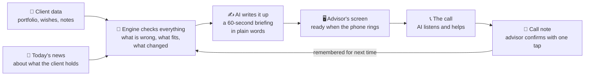
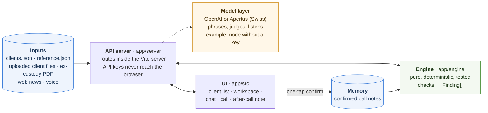
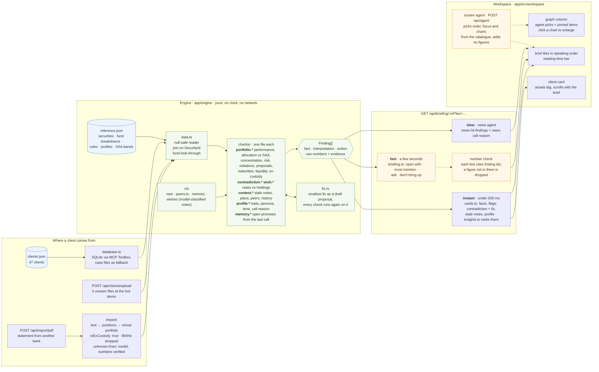
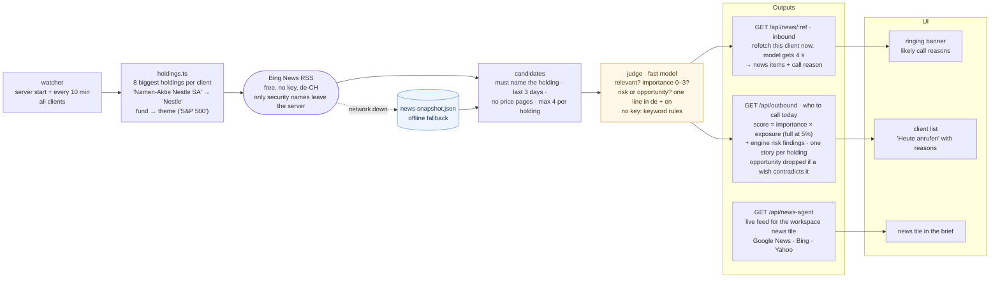
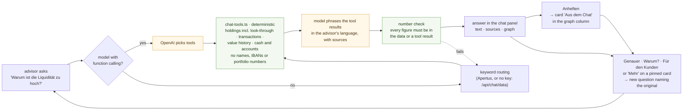
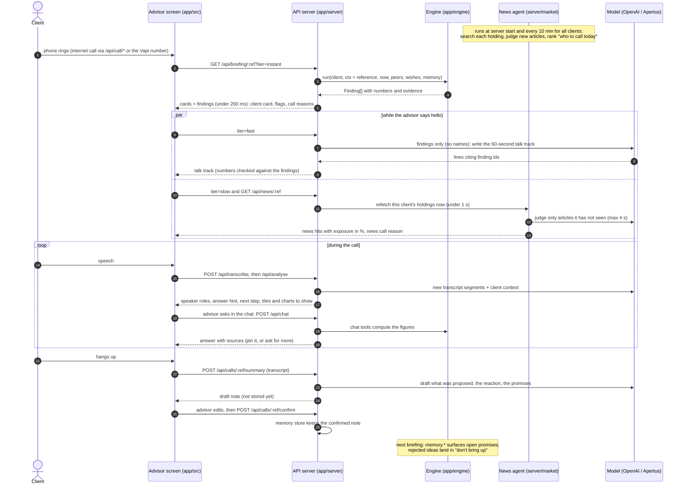

<div align="center">

<picture>
  <source media="(prefers-color-scheme: dark)" srcset="assets/logos/uro-dark.svg">
  
</picture>

<br><br>

<picture>
  <source media="(prefers-color-scheme: dark)" srcset="assets/logos/partners-dark.png">
  
</picture>

# From Ping to Pitch

Our entry for the UNRISKOMEGA challenge at START Global x Swiss AI Weeks 2026.

</div>

The phone rings. Before the advisor says hello, the screen shows a 60-second briefing built from the client's real data: what happened, what is wrong, what to say, what to propose. During the call the tool listens and helps. After the call it drafts the call note. Next time it remembers.

| Mode | Trigger | What happens |
| --- | --- | --- |
| **Inbound** | Client calls | Instant facts are on screen at pickup. LLM wording, news and history stream in during small talk. Everything is there in under 60 s. |
| **Outbound** | A rule violation, a news hit or a price move | The client lands on a "call today" list. The advisor opens a prep workspace, gets ready, then calls. |
| **After the call** | Call ends | AI drafts what was proposed, how the client reacted and which promises were made. One tap to confirm. The next briefing uses it: no repeated rejected ideas, open promises get closed. |

We do not "maximise revenue per client", we **never miss a suitable opportunity**: every suggestion passes the client's mandate, risk profile, ESG preference and stated wishes before it is shown.

> **Status.** This is a hackathon prototype built over two days (18 to 19 September 2026). It runs end to end on the real case data, but it is not production software: see [Mock vs production](#mock-vs-production) for what is real and what is stand-in.

## Demo

<!-- Drop the demo video here: drag the .mp4 into this file in the GitHub editor and it uploads and inserts a link, or paste a YouTube URL. -->

_Video coming soon._

What you see in the video, in order: the phone rings and the instant briefing is on screen before the advisor picks up; the 60-second talk track streams in; the advisor asks the data a question in the chat and pins the answer; the call ends and the AI drafts the call note; the next briefing for the same client remembers the promise.

## Docs

| | |
| --- | --- |
| [SUMMARY.md](SUMMARY.md) | Start here: what we built, how it works, and what every piece of information on the screen means, in plain words. |
| [PLAN.md](PLAN.md) | What we are building, architecture, contracts, tracks and owners, milestones, risks. |
| [CLAUDE.md](CLAUDE.md) | How we work: git, tests, code rules, grounding rules, data traps. |
| [task.md](task.md) | The official challenge brief and judging criteria. |
| [core-case/portfolio-data/DATA.md](core-case/portfolio-data/DATA.md) | Full data reference: every field and join key. |

## Quickstart

You need Node 22 or newer. No API keys are needed to try it.

```
git clone https://github.com/kvszef/from-ping-to-pitch.git
cd from-ping-to-pitch/app
npm ci
npm run dev
```

Open the URL Vite prints (normally `http://localhost:5173`), pick a client from the list, and the briefing builds in front of you. Use the **Demo-Anruf** menu in the workspace to simulate an inbound or outbound call.

**With AI models.** Copy `app/.env.example` to `app/.env.local` and fill in an OpenAI key, or an Apertus endpoint for the Swiss model. Add an ElevenLabs key for live transcription during the call. Without keys the app runs in example mode: the engine still computes everything, the wording comes from templates and the call is scripted. Keys stay in the Vite server and never reach the browser.

**Checks.** In `app/`, `npm run check` runs lint, typecheck and the tests (400+ tests, among them every engine check on all 47 clients in both languages). CI runs the same on every push.

**Phone bridge (optional).** [phone/](phone/) connects a real phone number via SignalWire, Twilio or Vapi so a client can actually call the demo. See [phone/README.md](phone/README.md).

## How it works

### The short version



The engine does the maths, the AI only puts it into words. If the data does not say it, the screen does not show it.

### The detailed version

Five diagrams, from the big picture down to a single call. Solid arrows carry data; dotted arrows are optional model steps. Every model step has a fallback that works without a key, so the app never goes blank.

#### 1 · The big picture



**The engine computes, the model phrases.** No number reaches the screen unless deterministic code produced it. Every statement is a `fact`, an `interpretation` or an `action` and names its source. If the data does not support an answer, the tool says so. No client names, IBANs or account numbers go to a model, a log or a commit.

#### 2 · The briefing: from data to the 60-second talk track



#### 3 · News: inbound call reason and the outbound "call today" list



#### 4 · The chat: ask the data, pin the answer, ask for more



#### 5 · One call, from ring to memory



Connecting a piece means registering it: checks (`app/engine/checks/`), briefing sections (`instant | fast | slow`) and cards (`app/src/cards/registry.tsx`) are each a registry. Details and the v0 contracts are in [PLAN.md](PLAN.md#3-architecture).

What the real data already proves:

- **Contradictions hide inside funds.** 13 clients have a "no fossil fuels" note, 11 hold energy anyway, and for 10 of those it is only visible through fund look-through.
- **Notes expire.** A "property within 12 months" note from a year ago becomes a question, not a fact.
- **Memory works from minute zero.** 76 proposals in the data are already rejected, so "don't repeat rejected ideas" needs no call history.

## Mock vs production

| Piece | Today | Production |
| --- | --- | --- |
| Client data in the UI | Engine over `clients.json` (via SQLite and MCP Toolbox, case files as fallback), uploaded files and imported ex-custody PDFs; the three sample clients in `app/src/data/mock.ts` only when the API is down | Same, fed from the bank's core system |
| Briefing wording, chat, call analysis | LLM via OpenAI or Apertus (OpenAI-compatible); example mode without keys (`app/src/workspace/brain.ts`) | Same, phrasing engine findings only |
| Live transcription | ElevenLabs speech-to-text; scripted call as fallback | Same |
| News | Live web news per holding (Bing News RSS, free, no key), judged by the model, refreshed every 10 min; saved snapshot offline | Licensed feed (e.g. SIX, Refinitiv) behind the same interface (`app/server/market/`) |
| CIO house view | An **example** house view (`app/engine/houseview.ts`, labelled "Beispiel" on screen). The engine check `cio.house-view` compares every portfolio with it deterministically (look-through exposures vs SAA targets); opportunities only within the mandate band, stated wishes and the ESG floor, products from the bank's recommendation list | The bank's monthly CIO view in the same JSON shape via `HOUSE_VIEW_FILE` (e.g. read from the CIO PDF with the ex-custody import path); nothing else changes |
| Call memory | Confirmed call notes in the server's memory (`app/server/memory/`), lost on restart; rejected proposals from the data from minute zero | SQLite or the bank's CRM, same `CallNote` shape |

Every live dependency has an offline fallback, so the demo never dies.

## Repo layout

| | |
| --- | --- |
| [app/](app/) | The application: React + Vite UI (`src/`), API inside the Vite server (`server/`), engine (`engine/`). |
| [core-case/portfolio-data/](core-case/portfolio-data/) | The dataset: `clients.json` (47 clients: portfolios, holdings, proposals, transactions, violations, notes) and `reference.json` (security master data, fund breakdowns, suitability rules, profiles, target allocations). |
| [core-case/GUI-screenshots/](core-case/GUI-screenshots/) | Reference screenshots of the current advisory UI. |
| [side-challenge/](side-challenge/) | Ten quarterly client reports (Q4 2025) as PDFs. |
| [assets/logos/](assets/logos/) | Brand logos, `*-light` and `*-dark` variants. |

Three further client files in the shape of `clients.json` are handed over at the live demo, so the app accepts uploads and the engine never throws on securities it has not seen.

## Data traps

Verified against the real files; the full list is in [CLAUDE.md](CLAUDE.md#data-traps-verified-against-the-real-files).

- **Null and absent both happen.** `DATA.md` says "absent, never null", but 20 clients have `SuitabilityViolations: null`. Always `x ?? []`.
- **Join on `SecurityId`, not `Isin`.** One ISIN can be several securities, one per currency.
- **Mind the units.** Position and SAA percentages are fractions 0–1; `FundUnbundlingMappings[].Weight` is 0–100.
- **Use the `SAA_*` fields** to compare holdings against target allocations.
- **Dates are shifted.** Engine logic never reads the wall clock; the date arrives as `ctx.now`.
- **Account `Currency` can be a crypto ticker** (`BTC`, `ETH`), not an ISO code.
- **IBANs in the data are real.** No names, IBANs or account numbers go to an LLM, a log or a commit.

## Team

Built at START Hack 2026 in St. Gallen by Kaushik Vempati (live call copilot, the whole frontend and UX, news fetching), Arash Bayat (engine and briefing) and Ahmet Emre Savaseri (database and pitch). We used Claude Code as a pair programmer throughout; [CLAUDE.md](CLAUDE.md) is the working agreement we gave it.

## License

The code and our documentation are released under the [MIT License](LICENSE). The challenge material from UNRISKOMEGA AG (case data, reference screenshots, quarterly reports, logos) is not ours and is not covered by it; see the note at the end of the LICENSE file.
