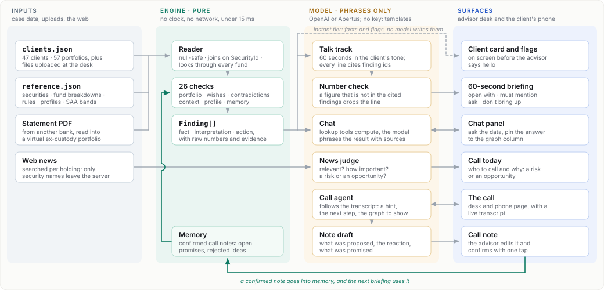

<div align="center">

# From Ping to Pitch

An AI copilot for wealth managers · UNRISKOMEGA challenge · START Global x Swiss AI Weeks 2026

</div>

The phone rings. Before the advisor says hello, the screen shows a 60-second briefing built from the client's real data: what happened, what is wrong, what to say, what to propose. During the call the tool listens and brings up the right figure. After the call it drafts the call note, and the next briefing remembers it.

The engine computes, the model phrases. No number reaches the screen unless deterministic code produced it.

`47 case clients` · `26 engine checks` · `under 15 ms per client` · `430+ tests` · `English and German` · `runs without an API key`

## Demo

<!-- For a player inside this page: on github.com, edit this file, put the cursor on the empty line below and drag phonecall_demo.mp4 in. GitHub uploads it and inserts a https://github.com/user-attachments/assets/... link, which renders as a player. -->

**[Watch the demo call](phonecall_demo.mp4)** (2 minutes, English) · [subtitles](phonecall_demo.srt)

A client calls, and her briefing is on screen before the advisor picks up. While the call is transcribed, the screen brings up what she asks about: first how the portfolio has done, then her top five positions. She asks for a PDF summary by the evening. When the call ends, the AI drafts the call note with that promise in it, and one tap saves it for the next call.

Our entry for the UNRISKOMEGA challenge at START Global x Swiss AI Weeks 2026, built over two days (18 and 19 September 2026). It runs end to end on the real case data, but it is a prototype: [Mock vs production](#mock-vs-production) says what is real and what is a stand-in. [SUMMARY.md](SUMMARY.md) explains every item on the screen in plain words, and [task.md](task.md) summarises the challenge.

---

## What it does

**Briefs before hello.** The screen fills in three waves. The instant wave (client card, flags, contradictions and a template talk track) comes from deterministic code alone: over HTTP on a laptop it takes a median of 3.5 ms across all 50 clients, measured without a key. With a key, the model rewrites the talk track in the client's tone in about 7 seconds, and news on the client's holdings follows. The talk track has four blocks: open with, must mention, ask, and don't bring up.

**Finds what is wrong, inside the funds too.** 26 checks compare the holdings with the mandate band, the risk profile, the bank's own rules and what the client said they want. Wishes are checked through every fund: 13 clients have a "no fossil fuels" note, 11 of them hold energy anyway, and for 10 of those it is only visible through fund look-through. Each contradiction comes with the smallest sale that fixes it, and every check runs again on the fixed portfolio before the fix is shown.

**Never repeats a rejected idea.** 76 proposals in the data are already rejected, so the rule against repeating rejected ideas works from minute zero, with no call history. They land in "don't bring up".

**Turns old notes into questions.** A "property within 12 months" note from a year ago becomes a question, not a fact.

**Answers during the call.** The advisor asks the data in the chat: a holding (also inside funds), transactions, cash, value history. Lookup tools compute, the model phrases, every figure is checked against the data, and the answer can be pinned next to the briefing. During a live call, a screen agent follows the transcript and shows the one graph that answers what the client just asked.

**Writes the call note.** After the call, the model drafts what was proposed, how the client reacted and what was promised. Swiss law (FIDLEG) requires that note. One tap confirms it, and open promises come back in the next briefing.

**Says who to call today.** Every 10 minutes a watcher searches the news for each client's biggest holdings. A model judges each article (relevant? important? risk or opportunity?), and the client list ranks who to call and why. An opportunity is dropped when one of the client's stated wishes contradicts it.

**Reads other banks' statements.** A PDF statement from another bank becomes a virtual portfolio, so the briefing covers the client's whole wealth.

**Survives files it has never seen.** Three unseen client files were handed over at the live demo. Unknown securities fall back to the position's own fields and are labelled "unclassified"; the engine never throws. We rehearsed this before the demo with three made-up files full of nulls, crypto accounts and unknown securities. The handed-over files are not ours and are not in this repo; [demo-clients/](demo-clients/) holds three made-up clients of our own in the same format: a "no fossil fuels" wish broken through funds, a property plan whose window has passed, and a one-position portfolio with five rejected ideas.

---

## How it fits together

Four lanes. The engine is the only part that computes, the model layer only puts its findings into words, and every surface shows what one of them produced.



Five rules hold everywhere:

* **The engine is pure.** No clock, no network, no DOM: the date arrives as `ctx.now`. The same code runs on the 47 case clients and on a file uploaded a minute ago.
* **The model only phrases.** Every line it writes cites finding ids. If a line holds a figure that is not in those findings, it is dropped and the template line is used instead.
* **A suggestion is shown only if it fits.** It must pass the client's mandate, risk profile, ESG preference and stated wishes. We do not maximise revenue per client; we never miss a suitable opportunity.
* **Every model step has an offline fallback.** Without a key you get the template briefing, keyword chat and the keyword news judge. Without a network, a saved news snapshot. Without a microphone, a scripted call. The demo never goes blank.
* **Nothing identifying leaves.** No client names, IBANs or account numbers go to a model, a log or a commit. Only security names go to the news search.

[docs/architecture.md](docs/architecture.md) has the detailed walkthrough: five diagrams, from the big picture down to a single call. The original contracts are in [PLAN.md](PLAN.md#3-architecture).

---

## Setup

Requires Node 22 or newer. No API key is needed to try it.

```bash
git clone https://github.com/kvszef/from-ping-to-pitch.git
cd from-ping-to-pitch/app
npm ci
cp .env.example .env.local   # optional, then fill in the keys you have
```

**Case data.** The client and reference data belong to UNRISKOMEGA AG and the organisers, so they are not in this repo. `npm ci` (in `app/` or `phone/`) downloads them from the organisers' public repository, [START-Hack/unriskomega-2026](https://github.com/START-Hack/unriskomega-2026), at a pinned commit, checks every file against its hash and puts them in `core-case/` and `side-challenge/`. Offline it only warns; run `npm run case-data` once you are online. The app and the tests need these files.

Without keys the app runs in example mode: the engine still computes everything, the wording comes from templates and the call is scripted. Keys stay in the Vite server and never reach the browser.

| Variable | Needed for | Where to get it |
|---|---|---|
| `OPENAI_API_KEY` | the talk track in the client's tone, the chat, the call agent, the note draft, the news judge | <https://platform.openai.com/api-keys> |
| `APERTUS_BASE_URL` / `APERTUS_API_KEY` / `APERTUS_MODEL` | the same with Apertus, the Swiss open model | any OpenAI-compatible host that serves Apertus |
| `ELEVENLABS_API_KEY` | live transcription during the call | <https://elevenlabs.io/app/settings/api-keys> |
| `CF_TURN_KEY_ID` / `CF_TURN_API_TOKEN` | optional audio relay for networks that block the direct call link | Cloudflare dashboard, Realtime, TURN Server |

Each model is set separately, so a cost decision about one does not leak into another:

```bash
OPENAI_MODEL=gpt-4o            # the briefing and the advisor chat
OPENAI_MODEL_FAST=gpt-4o-mini  # analysis during the call
OPENAI_MODEL_AGENT=            # optional: a stronger model for the live call agent
```

## Running

```bash
npm run dev     # app and API on http://localhost:5173
npm run check   # lint, typecheck and the tests
npm test        # tests only (npm run test:watch re-runs on save)
npm run demo    # stage mode plus a cloudflared tunnel, so a phone can join the call over HTTPS
```

Open the URL Vite prints, pick a client from the list, and the briefing builds in front of you. The phone icon (**Demo-Anruf**) in the workspace simulates an inbound or outbound call. `/call.html` is the client's side of a live call between two devices.

The test suite includes every engine check on all 47 clients in both languages, and CI runs `npm run check` on every push.

**Client data.** The app first tries the SQLite database behind MCP Toolbox (`cd phone && npm run load-data && npm run toolbox`). If the database does not answer, it reads the case files and says so in the server log. Set `DATA_SOURCE=dateien` to skip the database.

**Phone bridge (optional).** [phone/](phone/) connects a real phone number through SignalWire, Twilio or Vapi, so a client can actually call the demo. See [phone/README.md](phone/README.md).

---

## Mock vs production

| Piece | Today | Production |
| --- | --- | --- |
| Client data in the UI | Engine over `clients.json` and our demo clients (via SQLite and MCP Toolbox, case files as fallback), uploaded files and imported ex-custody PDFs; the three sample clients in `app/src/data/mock.ts` only when the API is down | Same, fed from the bank's core system |
| Briefing wording, chat, call analysis | LLM via OpenAI or Apertus (OpenAI-compatible); example mode without keys (`app/src/workspace/brain.ts`) | Same, phrasing engine findings only |
| Live transcription | ElevenLabs speech-to-text; scripted call as fallback | Same |
| News | Live web news per holding (Bing News RSS, free, no key), judged by the model, refreshed every 10 min; saved snapshot offline | Licensed feed (e.g. SIX, Refinitiv) behind the same interface (`app/server/market/`) |
| CIO house view | An **example** house view (`app/engine/houseview.ts`, labelled "Beispiel" on screen). The engine check `cio.house-view` compares every portfolio with it deterministically (look-through exposures vs SAA targets); opportunities only within the mandate band, stated wishes and the ESG floor, products from the bank's recommendation list | The bank's monthly CIO view in the same JSON shape via `HOUSE_VIEW_FILE` (e.g. read from the CIO PDF with the ex-custody import path); nothing else changes |
| Call memory | Confirmed call notes in the server's memory (`app/server/memory/`), lost on restart; rejected proposals from the data from minute zero | SQLite or the bank's CRM, same `CallNote` shape |

## How this was built

Two days, three people, one working agreement. [CLAUDE.md](CLAUDE.md) is the set of rules we gave Claude Code, our pair programmer throughout. It keeps the engine pure, gives every check a test against the real `clients.json` (one client where it must fire, one where it must not), and asks for a failing test before every bug fix. [PLAN.md](PLAN.md) and [PROGRESS.md](PROGRESS.md) are the plan and the working board from those two days, kept as written. [AUDIT.md](AUDIT.md) is the content audit of the numbers on screen.

Before the demo we rehearsed with three made-up client files built to break things: securities the reference data does not know, a crypto account, explicit nulls, an unknown risk profile, an empty portfolio, one ISIN in two currencies. That rehearsal found four bugs, among them an engine that called a portfolio "below the minimum share quota" when half of it was unclassified. All four were fixed before the demo.

## Layout

```
app/              React + Vite UI (src/), the API inside the Vite server (server/), the engine (engine/)
demo-clients/     three made-up clients of our own (DEMO-01 to DEMO-03), loaded next to the case clients
phone/            optional bridge for a real phone number, and the SQLite + MCP Toolbox data path
docs/             the architecture diagram and the detailed walkthrough
scripts/          case-data.mjs, which downloads the case data on npm ci

Downloaded, not committed:
core-case/        clients.json, reference.json and DATA.md; extra client files dropped into
                  core-case/portfolio-data/new-clients/ are loaded too and stay local
side-challenge/   ten quarterly client reports (Q4 2025) as PDFs, for the ex-custody import
```

The organisers' [DATA.md](https://github.com/START-Hack/unriskomega-2026/blob/134d6ff9343b8703a63a7279043c57c09345d45b/core-case/portfolio-data/DATA.md) documents every field and join key.

## Data traps

Verified against the real files; the full list is in [CLAUDE.md](CLAUDE.md#data-traps-verified-against-the-real-files).

- **Null and absent both happen.** `DATA.md` says "absent, never null", but 20 clients have `SuitabilityViolations: null`. Always `x ?? []`.
- **Join on `SecurityId`, not `Isin`.** One ISIN can be several securities, one per currency.
- **Mind the units.** Position and SAA percentages are fractions 0–1; `FundUnbundlingMappings[].Weight` is 0–100.
- **Use the `SAA_*` fields** to compare holdings against target allocations.
- **Dates are shifted.** Engine logic never reads the wall clock; the date arrives as `ctx.now`.
- **Account `Currency` can be a crypto ticker** (`BTC`, `ETH`), not an ISO code.
- **IBANs would be real.** The source format passes them through as-is (`DATA.md`); the case files are not in this repo and our demo clients hold none. No names, IBANs or account numbers go to an LLM, a log or a commit.

## Team

Built at START Hack 2026 in St. Gallen by Kaushik Vempati (live call copilot, the whole frontend and UX, news fetching), Arash Bayat (engine, call transcription, the call demo and the 60-second briefing feed the advisor sees during the call) and Ahmet Emre Savaseri (database and pitch).

## License

The code, our documentation and the demo clients are released under the [MIT License](LICENSE). The challenge material from UNRISKOMEGA AG (case data, reference screenshots, quarterly reports, logos) is not ours, is not in this repository and is not covered by it; see the note at the end of the LICENSE file.
